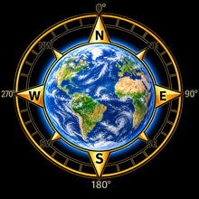

*[Lees dit in het Nederlands](README.nl.md)*

<p align="center"></p>

# PstRotator for Home Assistant

[](https://github.com/hacs/integration)

Made by [ON4NDO](https://www.qrz.com/db/ON4NDO).

Control [PstRotator](https://www.qsl.net/yo3dmu/index_Page346.htm) (YO3DMU)
from Home Assistant with a colorful, interactive azimuthal world map: click
anywhere on the map and the antenna rotator turns straight to that bearing.

## What's included

- **Backend integration** that creates a `number` entity for the commanded
  azimuth. Every change (from the map, the HA UI, a service call, or an
  automation) is forwarded to PstRotator over the network.
- **Lovelace card** (`pstrotator-card`) with an **azimuthal-equidistant
  world map** centered on your HA home location. This projection was
  chosen deliberately instead of a plain Mercator world map: the angle of
  every point on the map relative to the center is *exactly* the true
  compass bearing (great-circle bearing) — precisely what a rotator needs.
  - Click anywhere on the map, or press and hold the line and drag it
    around → the rotator follows that direction.
  - `+5°` / `−5°` buttons (step size configurable) for fine adjustment, and
    zoom in/out buttons above them (the full-world view is the maximum
    zoom-out level).
  - Every country rendered in its own color (a deterministic palette, so
    colors stay stable across reloads), plus distance rings and a compass
    rose with N/E/S/W. Set `land_color` to force every country to the same
    flat color instead.
  - Home location configurable via a **QTH locator** (e.g. `JO32wd`),
    manual coordinates, or automatically from Home Assistant's own home
    location.
  - Card text follows Home Assistant's own language (English/Dutch for
    now, falling back to English).
- **Storm position**: configure an azimuth and a wind speed sensor +
  threshold, and the antenna automatically turns to that azimuth once wind
  speed crosses the threshold. A **Storm** button also appears on the card
  for turning to it manually at any time.
- **Live position + beam triangle**: when using the default native UDP
  protocol or rotctld, the integration queries PstRotator's *actual*
  antenna position (not just the commanded target) every 0.5s while it's
  moving, continuing for 15s after it settles before dropping back to an
  idle poll. The card draws a transparent triangle for the antenna's
  beamwidth — apex at the home location, centered on the real position —
  that fades out once polling goes idle. Configure the beamwidth directly,
  or enter the antenna's gain (dBi) to have it calculated automatically.

## Installation via HACS

1. HACS → top-right **⋮** → **Custom repositories**.
2. Add this repository URL, category **Integration**.
3. Search for **PstRotator** in HACS and install it.
4. Restart Home Assistant.
5. **Settings → Devices & services → Add integration → PstRotator**.

## Configuring PstRotator

By default this integration sends **PstRotator's own native UDP command**
(`<PST><AZIMUTH>123</AZIMUTH></PST>` on port `12000`) — the input
PstRotator listens for out of the box, so there's nothing to enable inside
PstRotator itself:

1. Note the **IP address** of the PC running PstRotator.
2. Enter that **host/IP address** when setting up the integration in Home
   Assistant (the port defaults to `12000`, adjustable later through the
   integration's options).

Two alternative protocols are available under **Protocol** in the
integration's options, if you need them:

- **Hamlib rotctld-compatible** — if you enabled PstRotator's "Hamlib Net
  rotctl" interface (Settings → Rotor interfacing), typically on port
  `4533`.
- **Custom text command** — set your own command template, using `{az}` as
  a placeholder for the azimuth, for example:

  ```
  AZ{az:.1f}\n
  ```

## Home location (map center)

The center of the map — and therefore the zero reference for every
computed bearing — is determined in this order of priority:

1. A **QTH locator** (Maidenhead grid square, e.g. `JO32` or, more
   precisely, `JO32wd`), entered during setup or via the integration's
   options. This is the recommended approach: more precise than a country,
   and the notation amateur radio operators already use.
2. Manual **latitude/longitude**, also via the integration's options, for
   anyone who prefers plain coordinates.
3. Otherwise, automatically, Home Assistant's own **home location** (as
   set under **Settings → System → General**).

This location is passed to the card automatically via the `number` entity
— you don't need to change anything in the card configuration itself,
unless you deliberately want to override it (see `home_latitude` /
`home_longitude` below).

## Storm position

Open the integration's options (**Settings → Devices & services →
PstRotator → ⋮ → Options**) and pick **Storm** from the menu:

- **Storm position azimuth** — where the antenna should turn to.
- **Wind speed sensor** — pick any `sensor` entity that reports wind speed
  (e.g. from a local weather station integration).
- **Wind threshold** — once the sensor's value goes above this, the
  antenna turns to the storm azimuth automatically (in whatever unit that
  sensor reports in).

Leave the wind speed sensor empty to turn this off. Either way, the
**Storm** button on the card always lets you turn to that azimuth by hand.

## Antenna beamwidth and live position

Pick **Antenna** from the same options menu to configure:

- **Beamwidth** — the antenna's -3dB beamwidth in degrees, entered
  directly, *or*
- **Antenna gain (dBi)** — if set, the beamwidth is calculated from this
  instead (Kraus' approximation for a symmetric beam: `θ ≈ √(41253 / G)`).
  This is a rule-of-thumb figure, not exact for any specific antenna
  design. Gain takes priority over a manually entered beamwidth.

With either set, the card draws a semi-transparent triangle representing
the antenna's beam, apex at the home location.

This only works with the default native UDP protocol or with rotctld —
PstRotator's manual documents `<PST>AZ?</PST>` as the position query,
answered as `AZ:xxx.x` on UDP port + 1 (e.g. 12001 for the default port
12000). The integration polls this every 0.5s while the antenna is
moving, keeps polling for 15s after it settles, then drops back to an
idle poll until the next command or a detected (e.g. manual) movement.
The beam triangle fades out while idle and back in once tracking resumes.

## Adding the card to your dashboard

After installation the card is automatically registered as a Lovelace
resource. Then add a card with:

```yaml
type: custom:pstrotator-card
entity: number.pstrotator_azimuth
step: 5
```

(`title` is optional — leave it out, as above, to keep the header free for
just the Storm button and the azimuth readout.)

Optional configuration options:

| Option | Description | Default |
|---|---|---|
| `entity` | **(required)** PstRotator's `number` entity | — |
| `title` | Title shown above the card | *(none)* |
| `step` | Step size of the +/− buttons | `5` |
| `home_latitude` / `home_longitude` | Override the location from the integration/HA | see "Home location" above |
| `land_color` | Force every country to this one flat color instead of the per-country palette | *(per-country palette)* |
| `land_stroke`, `ocean_from`, `ocean_to`, `line_color` | Customize other colors | see `pstrotator-card.js` |

If the card doesn't appear automatically in the resource list, add it
manually via **Settings → Dashboards → Resources**:

- URL: `/pstrotator_files/pstrotator-card.js`
- Type: JavaScript module

## Services / automations

The integration uses the standard `number.set_value` service, so you can
drive the azimuth directly from automations too:

```yaml
action: number.set_value
target:
  entity_id: number.pstrotator_azimuth
data:
  value: 123.4
```

## Map data

The world data (continents) comes from [Natural Earth](https://www.naturalearthdata.com/)
(110m resolution, public domain) and is bundled locally — no external data
is fetched at runtime.

## Troubleshooting

`tools/pstrotator_query_test.py` is a standalone script (stdlib only) that
sends the position query PstRotator expects and prints exactly what comes
back, useful for checking connectivity/firewalls independently of Home
Assistant:

```
python3 tools/pstrotator_query_test.py <pstrotator-host> [port]
```

## Branding

The integration ships its own icon/logo in `custom_components/pstrotator/brand/`
(`icon.png`, `icon@2x.png`, `logo.png`, `logo@2x.png`). Since Home Assistant
2026.3, local brand images like these are picked up automatically and take
priority over the [home-assistant/brands](https://github.com/home-assistant/brands)
CDN — no separate submission needed.

## License

MIT, see [LICENSE](LICENSE).
