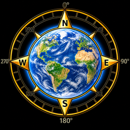
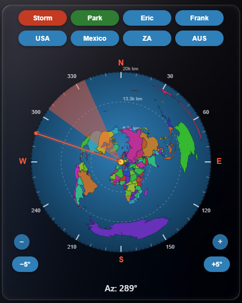

*[Read this in English](README.md)*
*[Step by step configuration (EN)](https://htmlpreview.github.io/?https://raw.githubusercontent.com/Wilfred-Swinkels/HAm-rotator/main/docs/setup.html)*

<p align="center"></p>

# HAm-rotator voor Home Assistant

[](https://github.com/hacs/integration)

Gemaakt door [ON4NDO](https://www.qrz.com/db/ON4NDO).

Besturing van je antenne-rotor vanuit Home Assistant, met een kleurrijke,
interactieve azimutale wereldkaart: klik op de kaart en de antennerotor
draait direct die richting op. Praat rechtstreeks met een Yaesu
GS-232(B)-compatibele controller, met [PstRotator](https://www.qsl.net/yo3dmu/index_Page346.htm)
(YO3DMU), met Hamlib rotctld, of met een eigen custom commando.

<p align="center"></p>

Bekijk de [stap-voor-stap handleiding](https://htmlpreview.github.io/?https://raw.githubusercontent.com/Wilfred-Swinkels/HAm-rotator/main/docs/setup.nl.html) voor een complete uitleg, van het aanmaken van de entiteit tot het toevoegen van de kaart aan je dashboard.

## Wat zit erin

- **Backend-integratie** die een `number`-entiteit aanmaakt voor de
  gecommandeerde azimuth. Elke wijziging (via de kaart, de HA-UI, een
  service-call of een automation) wordt doorgestuurd naar de
  rotorcontroller over het netwerk.
- **Lovelace-kaart** (`ham-rotator-card`) met een **azimutale equidistante
  wereldkaart**, gecentreerd op je HA-thuislocatie. Dit projectietype is
  bewust gekozen (in plaats van een gewone Mercator-wereldkaart): de hoek
  van elk punt op de kaart ten opzichte van het midden is *exact* de
  werkelijke kompaskoers (great-circle bearing) — precies wat een
  rotor nodig heeft.
  - Klik ergens op de kaart, of houd de muisknop ingedrukt en sleep de lijn
    rond → de rotor draait mee naar die richting.
  - `+5°` / `−5°` knoppen (stapgrootte instelbaar) om bij te sturen, en
    zoom in/uit-knoppen erboven (de volledige wereldkaart is het maximale
    uitzoomniveau).
  - Elk land in zijn eigen kleur (een vast, deterministisch palet — blijft
    gelijk bij herladen), plus afstandscirkels en een kompasroos met
    N/E/S/W. Stel `land_color` in om alle landen juist één vaste kleur te
    geven.
  - Thuislocatie instelbaar via **QTH-locator** (bv. `JO21QE`), handmatige
    coördinaten, of automatisch de HA-thuislocatie.
  - Teksten op de kaart volgen de taal van Home Assistant (op dit moment
    Engels/Nederlands, met Engels als terugval).
- **Stormstand**: stel een azimuth in plus een windsnelheid-sensor en
  drempelwaarde, en de antenne draait automatisch naar die stand zodra de
  windsnelheid boven de drempel komt. Er verschijnt ook een **Storm**-knop
  op de kaart om dit op elk moment handmatig te doen.
- **Live positie + bundel-driehoek**: bij een protocol dat de positie kan
  terugmelden (native PstRotator UDP, rotctld, of Yaesu GS-232) vraagt de
  integratie elke 0,5 sec de *werkelijke* antennestand op (niet alleen de
  ingestelde doelwaarde) zolang de antenne beweegt, en blijft dat nog
  15 sec doen nadat die tot stilstand is gekomen voordat 'ie terugvalt op
  een rustige polling. De kaart tekent een transparante driehoek voor de
  antennebundel — tophoek op de thuislocatie, gecentreerd op de werkelijke
  stand — die wegdimt zodra het pollen stopt. Stel de openingshoek direct
  in, of vul de antenne-gain (dBi) in om 'm automatisch te laten berekenen.

## Installatie via HACS

HAm-rotator staat in de HACS default-lijst, dus meestal volstaat:

1. HACS → zoek naar **HAm-rotator** en installeer.
2. Herstart Home Assistant.
3. **Instellingen → Apparaten & diensten → Integratie toevoegen → HAm-rotator**.

Staat 'ie nog niet in de zoekresultaten (net toegevoegd, of je HACS-cache is
verouderd)? Voeg 'm dan handmatig toe als custom repository:

1. HACS → rechtsboven **⋮** → **Custom repositories**.
2. Voeg deze repository-URL toe, categorie **Integration**.
3. Ga verder bij stap 1 hierboven.

## Je rotorcontroller configureren

Vier protocollen zijn beschikbaar bij **Protocol** tijdens het instellen
van de integratie (en later via de opties):

- **Yaesu GS-232(B)** — praat rechtstreeks met een rotorcontroller die dit
  protocol zelf spreekt (bijvoorbeeld een Arco-controller), over TCP.
  Meestal poort `4533`, maar check de handleiding van je controller. Geen
  extra software ertussen nodig — de simpelste opzet als je hardware dit
  ondersteunt.
- **PstRotator native UDP** (standaard, poort `12000`) — stuurt
  [PstRotator](https://www.qsl.net/yo3dmu/index_Page346.htm)'s eigen
  UDP-commando (`<PST><AZIMUTH>123</AZIMUTH></PST>`), dat is wat
  PstRotator standaard al binnenkrijgt. Noteer het IP-adres van de PC
  waarop PstRotator draait en vul dat in als host.
- **Hamlib rotctld-compatible** — als je PstRotator's "Hamlib Net rotctl"
  interface hebt ingeschakeld (Settings → Rotor interfacing), meestal op
  poort `4533`, of elke andere rotctld-compatibele daemon.
- **Custom text command** — stel je eigen commando-template in, met `{az}`
  als plaatshouder voor de azimuth, bijvoorbeeld:

  ```
  AZ{az:.1f}\n
  ```

## Thuislocatie (midden van de kaart)

Het midden van de kaart — en dus de nulreferentie voor elke berekende
richting — wordt bepaald door, in volgorde van voorrang:

1. Een **QTH-locator** (Maidenhead grid square, bv. `JO21` of preciezer
   `JO21QE`), in te vullen bij het instellen of via de opties van de
   integratie. Dit is de aanbevolen manier: nauwkeuriger dan een land en
   voor radioamateurs de gebruikelijke notatie.
2. Handmatige **breedte-/lengtegraad**, ook via de integratie-opties, voor
   wie liever gewone coördinaten gebruikt.
3. Anders automatisch de **HA-thuislocatie** (zoals ingesteld onder
   **Instellingen → Systeem → Algemeen**).

Deze locatie wordt automatisch doorgegeven aan de kaart via de
`number`-entiteit — je hoeft niets in de kaart-configuratie zelf aan te
passen, tenzij je bewust wilt overschrijven (zie `home_latitude` /
`home_longitude` hieronder).

## Stormstand

Open de opties van de integratie (**Instellingen → Apparaten & diensten →
HAm-rotator → ⋮ → Opties**) en kies **Storm** uit het menu:

- **Stormstand azimuth** — waar de antenne naartoe moet draaien.
- **Windsnelheid-sensor** — kies een `sensor`-entiteit die windsnelheid
  rapporteert (bv. van een lokale weerstation-integratie).
- **Winddrempel** — zodra de sensorwaarde hierboven komt, draait de
  antenne automatisch naar de stormstand (in welke eenheid die sensor ook
  rapporteert).

Laat het windsensor-veld leeg om dit uit te zetten. De **Storm**-knop op
de kaart werkt sowieso altijd om er handmatig naartoe te draaien.

## Antenne-openingshoek en live positie

Kies **Antenne** uit hetzelfde opties-menu om in te stellen:

- **Openingshoek** — de -3dB-bundelbreedte van de antenne in graden,
  rechtstreeks in te vullen, *of*
- **Antenne-gain (dBi)** — indien ingevuld wordt de openingshoek hieruit
  berekend (Kraus-benadering voor een symmetrische bundel:
  `θ ≈ √(41253 / G)`). Dit is een vuistregel, geen exacte waarde per
  antenneontwerp. Gain heeft voorrang op een handmatig ingevulde
  openingshoek.

Zodra één van beide is ingesteld, tekent de kaart een halfdoorzichtige
driehoek voor de antennebundel, met de tophoek op de thuislocatie.

Dit werkt alleen met protocollen die de positie kunnen terugmelden: native
PstRotator UDP, rotctld, en Yaesu GS-232(B) — niet met het custom text
command-protocol, dat alleen kan versturen. Voor native UDP documenteert
PstRotator's handleiding `<PST>AZ?</PST>` als positie-query, beantwoord
als `AZ:xxx.x` op UDP-poort + 1 (bv. 12001 bij standaardpoort 12000). De
integratie vraagt dit elke 0,5 sec op zolang de antenne beweegt, blijft
dat nog 15 sec doen nadat die tot stilstand is gekomen, en valt daarna
terug op een rustige polling tot het volgende commando of een
gedetecteerde (bv. handmatige) beweging. De bundel-driehoek dimt weg
tijdens het rustige pollen en komt terug zodra er weer actief gevolgd
wordt.

## De kaart toevoegen aan je dashboard

Na installatie wordt de kaart automatisch als Lovelace-resource geregistreerd.
Voeg daarna een kaart toe met:

```yaml
type: custom:ham-rotator-card
entity: number.ham_rotator_azimuth
step: 5
```

(`title` is optioneel — laat 'm weg, zoals hierboven, zodat de header vrij
blijft voor alleen de Storm-knop en de azimuth-uitlezing.)

Optionele configuratie-opties:

| Optie | Omschrijving | Standaard |
|---|---|---|
| `entity` | **(verplicht)** De `number`-entiteit van de integratie | — |
| `title` | Titel boven de kaart | *(geen)* |
| `step` | Stapgrootte van de +/− knoppen | `5` |
| `home_latitude` / `home_longitude` | Overschrijf de locatie uit de integratie/HA | zie "Thuislocatie" hierboven |
| `land_color` | Forceer één vaste kleur voor alle landen i.p.v. het per-land-palet | *(per-land palet)* |
| `land_stroke`, `ocean_from`, `ocean_to`, `line_color` | Overige kleuren aanpassen | zie `ham-rotator-card.js` |

Als de kaart niet automatisch verschijnt in de resource-lijst, voeg hem
handmatig toe via **Instellingen → Dashboards → Resources**:

- URL: `/ham_rotator_files/ham-rotator-card.js`
- Type: JavaScript module

## Services / automations

De integratie gebruikt de standaard `number.set_value`-service, dus je kunt
de azimuth ook rechtstreeks vanuit automations aansturen:

```yaml
action: number.set_value
target:
  entity_id: number.ham_rotator_azimuth
data:
  value: 123.4
```

## Kaartdata

De werelddata (continenten) komt van [Natural Earth](https://www.naturalearthdata.com/)
(110m resolutie, publiek domein) en wordt lokaal meegeleverd — er wordt geen
externe data opgehaald tijdens gebruik.

## Problemen oplossen

`tools/pstrotator_query_test.py` is een standalone script (geen externe
dependencies) dat de positie-query stuurt die de PstRotator-software
verwacht en precies print wat er terugkomt — handig om
connectiviteit/firewalls te testen los van Home Assistant:

```
python3 tools/pstrotator_query_test.py <pstrotator-host> [poort]
```

## Branding

De integratie levert zijn eigen icoon/logo mee in `custom_components/ham_rotator/brand/`
(`icon.png`, `icon@2x.png`, `logo.png`, `logo@2x.png`). Sinds Home Assistant
2026.3 worden zulke lokale brand-afbeeldingen automatisch herkend en hebben
ze voorrang op de [home-assistant/brands](https://github.com/home-assistant/brands)
CDN — geen aparte indiening nodig.

## Licentie

MIT, zie [LICENSE](LICENSE).
