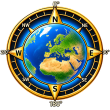

*[Read this in English](README.md)*

<p align="center"></p>

# PstRotator voor Home Assistant

[](https://github.com/hacs/integration)

Besturing van [PstRotator](https://www.qsl.net/yo3dmu/index_Page346.htm) (YO3DMU)
vanuit Home Assistant, met een kleurrijke, interactieve azimutale wereldkaart:
klik op de kaart en de antennerotor draait direct die richting op.

## Wat zit erin

- **Backend-integratie** die een `number`-entiteit aanmaakt voor de
  gecommandeerde azimuth. Elke wijziging (via de kaart, de HA-UI, een
  service-call of een automation) wordt doorgestuurd naar PstRotator over
  het netwerk.
- **Lovelace-kaart** (`pstrotator-card`) met een **azimutale equidistante
  wereldkaart**, gecentreerd op je HA-thuislocatie. Dit projectietype is
  bewust gekozen (in plaats van een gewone Mercator-wereldkaart): de hoek
  van elk punt op de kaart ten opzichte van het midden is *exact* de
  werkelijke kompaskoers (great-circle bearing) — precies wat een
  rotor nodig heeft.
  - Klik ergens op de kaart, of houd de muisknop ingedrukt en sleep de lijn
    rond → de rotor draait mee naar die richting.
  - `+5°` / `−5°` knoppen (stapgrootte instelbaar) om bij te sturen.
  - De richtingslijn is altijd exact de straal van de cirkel (vaste lengte,
    geen pijl) — alleen de hoek verandert.
  - Gekleurde continenten/oceaan, afstandscirkels (5000/10000/15000 km) en
    een kompasroos met N/E/S/W.
  - Thuislocatie instelbaar via **QTH-locator** (bv. `JO32wd`), handmatige
    coördinaten, of automatisch de HA-thuislocatie.

## Installatie via HACS

1. HACS → rechtsboven **⋮** → **Custom repositories**.
2. Voeg deze repository-URL toe, categorie **Integration**.
3. Zoek naar **PstRotator** in HACS en installeer.
4. Herstart Home Assistant.
5. **Instellingen → Apparaten & diensten → Integratie toevoegen → PstRotator**.

## PstRotator configureren

Deze integratie stuurt standaard **PstRotator's eigen UDP-commando**
(`<PST><AZIMUTH>123</AZIMUTH></PST>` op poort `12000`) — dat is wat
PstRotator standaard al binnenkrijgt, dus je hoeft niets in PstRotator
zelf aan te zetten:

1. Noteer het **IP-adres** van de PC waarop PstRotator draait.
2. Vul dat **host/IP-adres** in tijdens het instellen van de integratie in
   Home Assistant (de poort staat standaard op `12000`, later aanpasbaar
   via de opties van de integratie).

Twee alternatieve protocollen zijn beschikbaar bij **Protocol** in de
opties van de integratie, mocht je die nodig hebben:

- **Hamlib rotctld-compatible** — als je PstRotator's "Hamlib Net rotctl"
  interface hebt ingeschakeld (Settings → Rotor interfacing), meestal op
  poort `4533`.
- **Custom text command** — stel je eigen commando-template in, met `{az}`
  als plaatshouder voor de azimuth, bijvoorbeeld:

  ```
  AZ{az:.1f}\n
  ```

## Thuislocatie (midden van de kaart)

Het midden van de kaart — en dus de nulreferentie voor elke berekende
richting — wordt bepaald door, in volgorde van voorrang:

1. Een **QTH-locator** (Maidenhead grid square, bv. `JO32` of preciezer
   `JO32wd`), in te vullen bij het instellen of via de opties van de
   integratie. Dit is de aanbevolen manier: nauwkeuriger dan een land en
   voor radioamateurs de gebruikelijke notatie.
2. Handmatige **breedte-/lengtegraad**, ook via de integratie-opties, voor
   wie liever gewone coördinaten gebruikt.
3. Anders automatisch de **HA-thuislocatie** (zoals ingesteld onder
   **Instellingen → Systeem → Algemeen**).

Deze locatie wordt automatisch doorgegeven aan de kaart via de
`number`-entiteit — je hoeft niets in de kaart-configuratie zelf aan te
passen, tenzij je bewust wilt overschrijven (zie `home_latitude` /
`home_longitude` hieronder).

## De kaart toevoegen aan je dashboard

Na installatie wordt de kaart automatisch als Lovelace-resource geregistreerd.
Voeg daarna een kaart toe met:

```yaml
type: custom:pstrotator-card
entity: number.pstrotator_azimuth
title: Antenne richting
step: 5
```

Optionele configuratie-opties:

| Optie | Omschrijving | Standaard |
|---|---|---|
| `entity` | **(verplicht)** De `number`-entiteit van PstRotator | — |
| `title` | Titel boven de kaart | `PstRotator` |
| `step` | Stapgrootte van de +/− knoppen | `5` |
| `home_latitude` / `home_longitude` | Overschrijf de locatie uit de integratie/HA | zie "Thuislocatie" hierboven |
| `land_color`, `ocean_from`, `ocean_to`, `line_color` | Kleuren aanpassen | zie `pstrotator-card.js` |

Als de kaart niet automatisch verschijnt in de resource-lijst, voeg hem
handmatig toe via **Instellingen → Dashboards → Resources**:

- URL: `/pstrotator_files/pstrotator-card.js`
- Type: JavaScript module

## Services / automations

De integratie gebruikt de standaard `number.set_value`-service, dus je kunt
de azimuth ook rechtstreeks vanuit automations aansturen:

```yaml
action: number.set_value
target:
  entity_id: number.pstrotator_azimuth
data:
  value: 123.4
```

## Kaartdata

De werelddata (continenten) komt van [Natural Earth](https://www.naturalearthdata.com/)
(110m resolutie, publiek domein) en wordt lokaal meegeleverd — er wordt geen
externe data opgehaald tijdens gebruik.

## Branding

De map `brands/custom_integrations/pstrotator/` bevat icon/logo-afbeeldingen
in de afmetingen die [home-assistant/brands](https://github.com/home-assistant/brands)
verwacht (`icon.png` 256×256, `icon@2x.png` 512×512, idem voor `logo`). Die
daar via een PR indienen zorgt ervoor dat de integratie een eigen icoon
toont in het "Integratie toevoegen"-scherm in plaats van een generieke
placeholder.

## Licentie

MIT, zie [LICENSE](LICENSE).
