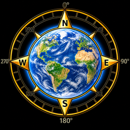

## HAm-rotator

Besturing van je antennerotor vanuit Home Assistant via een kleurrijke,
klikbare azimutale wereldkaart — rechtstreeks via Yaesu GS-232(B), via
PstRotator (YO3DMU), via Hamlib rotctld, of via een custom commando. Klik
een richting aan en de antennerotor draait direct die kant op. Met
`+5°` / `−5°` knoppen voor fijnafstelling.

**Na installatie:** Instellingen → Apparaten & diensten → Integratie
toevoegen → HAm-rotator. Zie de [README](README.md) voor het instellen van
je rotorcontroller en het toevoegen van de kaart aan je dashboard.
